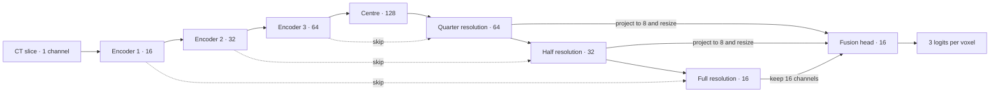

# Method worksheet

Team 9 is comparing four U-Net variants for pancreas and pancreatic tumour segmentation. The comparison uses the same CT preparation, case lists and training budget for every variant.

## Component references

- U-Net uses a contracting path to learn context and an expanding path to restore detail. We use the encoder, decoder and skip connections with padded 2D convolutions. [U-Net, Figure 1](https://arxiv.org/abs/1505.04597)
- The additive attention gate projects an encoder feature and a decoder signal, combines them, and uses a sigmoid weight to scale the skip feature. Our gate uses 2D 1×1 projections on an already aligned grid. [Attention U-Net, Section 2, Figure 2 and Equations 1–2](https://arxiv.org/html/1804.03999#S2)
- The full-scale connections in UNet 3+ combine maps from several resolutions at decoder stages. Our head uses this idea at the last decoder stage, with maps from the three decoder resolutions and a smaller set of connections. [UNet 3+, Section 2.1](https://arxiv.org/pdf/2004.08790)

## Preparation

| Setting | Choice |
| --- | --- |
| Input | One native-resolution axial CT slice, shaped 1 × height × width |
| Orientation | Reorder and flip to nearest RAS using the NIfTI affine |
| Intensity | Clip to −100 to 250 HU and scale to 0–1 |
| Masks | Preserve 0 background, 1 pancreas, and 2 tumour/mass throughout preparation |
| Training sample | Four tumour slices, four pancreas-only slices and four background slices per case per epoch when available. Reuse slices if a group is small and draw from the scan if a group is empty. |
| Training augmentation | Random left-right flip of the paired CT and mask |
| Validation and test | Predict every slice, undo orientation and evaluate on the original grid |

The native resolution keeps small tumours intact and raises GPU memory use. The model sees one slice at a time, so slice-to-slice consistency is an empirical question. The pilot will measure memory and elapsed time. The source metadata calls label 2 “cancer.” We retain the number and use tumour/mass in the report.

## Network

Each block uses two 3×3 convolutions, group normalization and ReLU. The decoder projects and upsamples its input to the corresponding skip size before concatenation. With attention enabled, the gate computes `sigmoid(psi(ReLU(Wx(skip) + Wg(decoder))))` and multiplies the skip by that map. In the fusion head, the full-resolution 16 channels and the two projected 8-channel maps make 32 channels. A convolution block reduces them to 16 before the three-class output. When fusion is off, the output uses the full-resolution decoder directly.

| Run | Skip gates | Fusion head |
| --- | --- | --- |
| `unet` | Off | Off |
| `attention` | On | Off |
| `fusion` | Off | On |
| `attention_fusion` | On | On |

The attention-only and fusion-only variants isolate each component with the same backbone. Keep claims about improvements tied to measured differences in both labels.

## Training and scoring

The initial settings are batch size 4, AdamW at 0.0003, weight decay 0.0001, and 30 epochs per comparison run. Cross-entropy covers all classes. Soft Dice is averaged over the foreground classes present in a training batch. The GPU pilot checks the budget and resume process before the full runs. Phase 3 produces the actual seed-42 case lists.

Validation uses Dice over the cases with each reference label. The mean of the two class means picks the checkpoint. Test scores use the frozen weights and the same complete-volume predictor. A present label that the model misses gets zero Dice, IoU and recall. Undefined precision or surface distances are left blank and counted separately. HD95 is calculated in millimetres by MONAI when both surfaces exist on an orthogonal grid. [MONAI Hausdorff distance](https://docs.monai.io/en/stable/metrics.html#hausdorff-distance)

The report still needs measured preflight, pilot and test outputs. The design above describes the code prepared for those runs.
