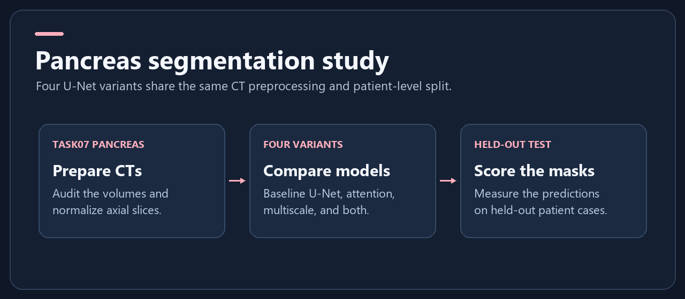

# Pancreas Segmentation

A comparative U-Net study for pancreas and pancreatic tumour segmentation from CT.

**Tech stack** · Python · PyTorch · MONAI · NiBabel · NumPy · SciPy · Streamlit



## Experiment design

Team 9 compares a baseline U-Net with attention, multi-scale fusion, and their combination on the same patient splits. The models process axial CT slices and predict background, pancreas, and tumour labels. This is a research project for comparing segmentation methods.

| Stage | Code |
| --- | --- |
| Audit and prepare data | [`prepare_data.py`](prepare_data.py) and [`dataset.py`](dataset.py) |
| Compare model variants | [`model.py`](model.py), [`train.py`](train.py), and [`evaluate.py`](evaluate.py) |
| Run inference | [`predict.py`](predict.py), the [checkpoint guide](MODEL_HANDOVER.md), and a [Streamlit demo](app.py) |

## Quick start

From a Linux environment with Python 3.11 or later, install the project dependencies and check the environment. Put a copy of the Medical Segmentation Decathlon Task07 Pancreas dataset next to `config.py` before running the audit.

```bash
python -m pip install -r requirements.txt
python run_project.py environment
python run_project.py audit
python run_project.py preflight --device cpu
```

The [experiment guide](EXPERIMENT_GUIDE.md) covers dataset retrieval, GPU training, evaluation, and demo workflows. The [project plan](PROJECT_PLAN.md) and [method worksheet](BASE_PAPER.md) describe the research setup.

## Tests and verification

The environment check verifies imports, storage, and CUDA availability. Preflight checks the input pipeline, output shapes, gradients, and checkpoint reload for all four models. The GPU pilot checks learning and checkpoint resume before full training. CT volumes, generated reports, run outputs, and weights are supplied separately or recreated during those steps.

## License

The project code is available under the [MIT License](LICENSE).
